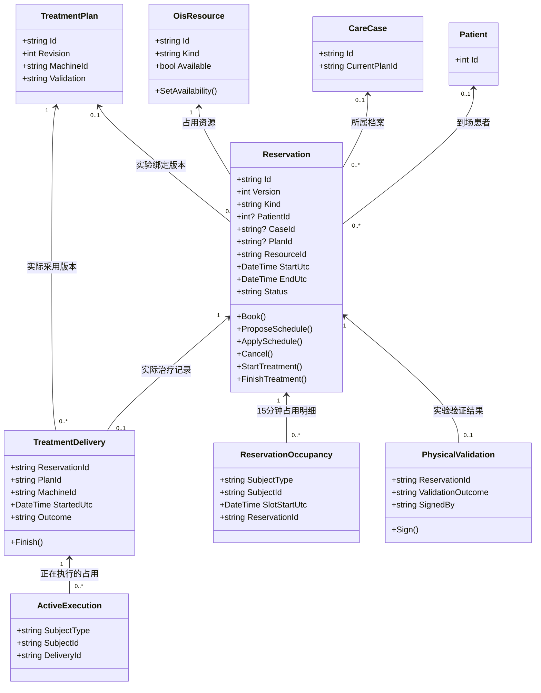
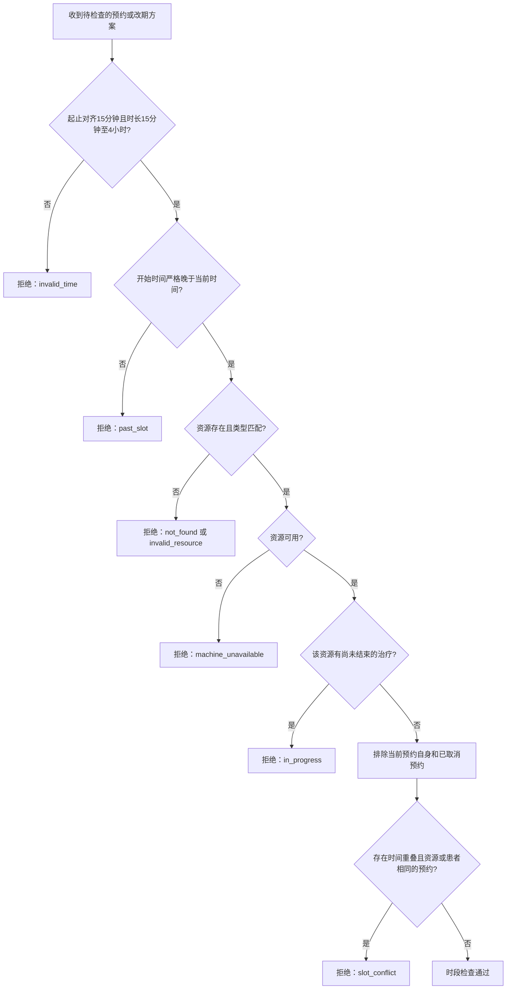
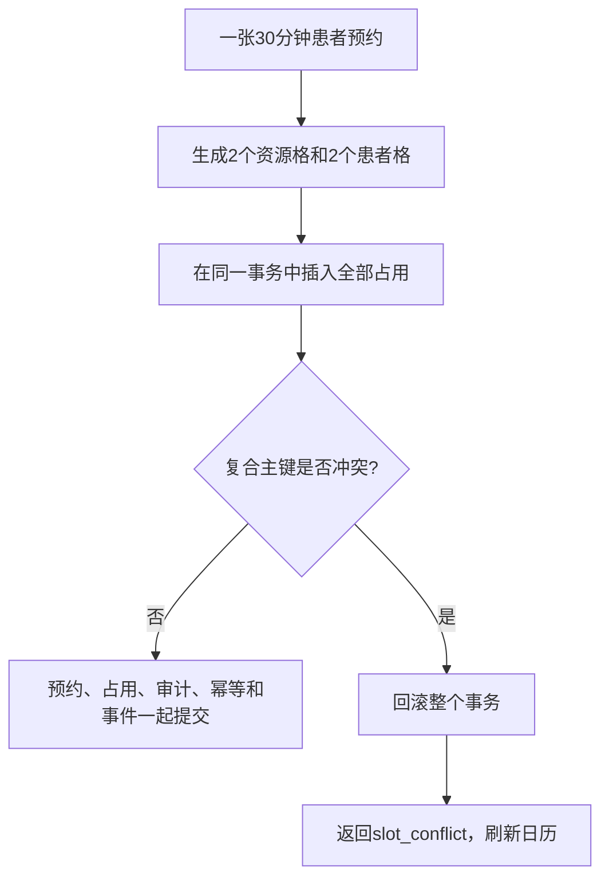
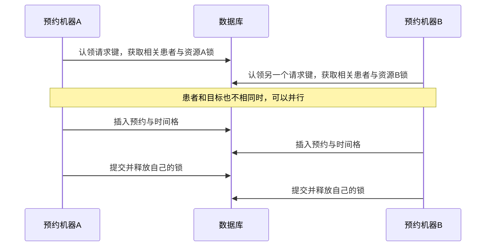
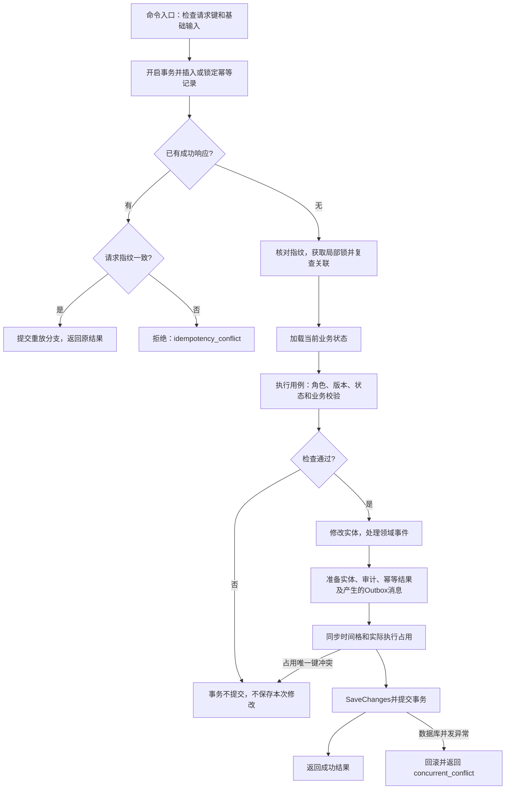
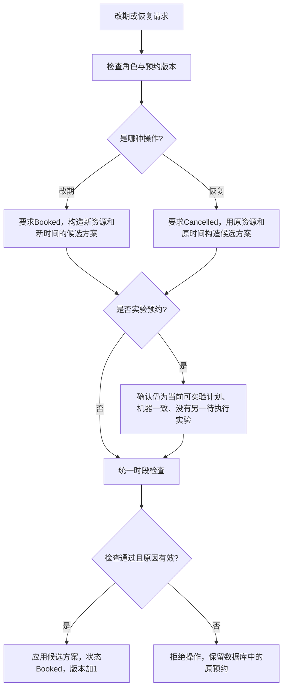
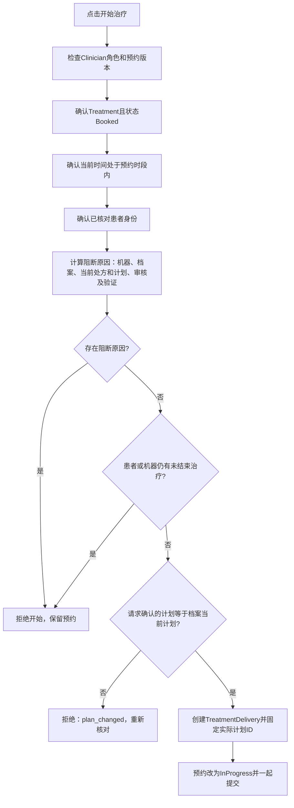
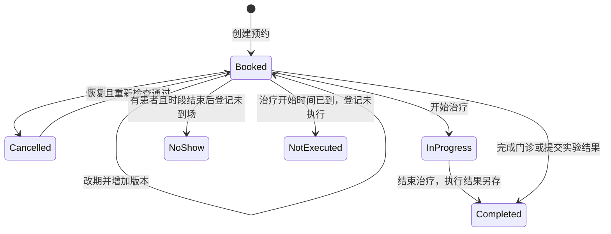

# 预约流程专项：实体怎么设计，冲突怎么处理

本文结合 ClinicFlow 当前代码，解释预约模块最容易混淆的三个问题：一条预约到底记录什么；哪些情况算冲突；两个人同时操作时，怎样避免数据出错。文中的图描述现有实现，末尾的改进方向单独标明，不代表已经实现。

阅读时可以先记住一句话：**预约负责占时间，执行记录负责记事实，排程规则负责判断能不能占，时间格唯一约束负责防止重复占用，事务负责保证整笔操作一起成功或失败。**

## 1. 先看一个具体场景

患者小王需要门诊、治疗计划验证以及正式治疗。它们都出现在日历里，但需要占用的对象不同：

| 活动 | 占用患者时间 | 占用哪种资源 | 还需要关联什么 |
| --- | --- | --- | --- |
| 门诊 `Consultation` | 是 | 接诊人员 `Clinician` | 患者；诊疗档案可选 |
| 治疗 `Treatment` | 是 | 机器 `Machine` | 患者及其诊疗档案 |
| 实验 `Experiment` | 否 | 机器 `Machine` | 当前的具体治疗计划版本、所属档案 |
| 维护 `Maintenance` | 否 | 机器 `Machine` | 必填维护原因 |

例如，机器 A 在 10:00—10:30 做小王的计划验证实验，小王可以同时去门诊，因为实验不要求患者到场。但机器 A 不能同时接待其他患者治疗。

如果小王已经在 10:00—10:30 预约门诊，就不能同时去机器 B 治疗。机器不同，也解决不了患者本人分身的问题。

这就是本项目统一排程的基础：**先判断时间是否重叠，再判断是否争用同一个人或同一项资源。**

## 2. 为什么用一个 Reservation 表示四种预约

四类活动都有相同的骨架：编号、资源、开始时间、结束时间、状态。项目用一个 `Reservation` 实体，加上 `Kind` 区分活动类型。

这样，机器上的治疗、实验、维护进入同一份预约集合，可以使用同一套冲突检查。如果分成互不关联的四张预约表，每次排期都要跨表检查，容易漏掉“治疗撞上维护”这样的情况。

统一实体的代价是部分字段允许为空，因此需要应用层按照预约类型检查组合是否合法。**字段允许为空，不等于业务上随便填。**

### 2.1 Reservation 的字段各管什么

| 字段 | 直白解释 | 当前约定 |
| --- | --- | --- |
| `Id` | 这张预约单的身份 | 改期不换编号 |
| `Version` | 这张预约单改到第几版了 | 初始为 1，相关状态变更或改期后递增 |
| `Kind` | 做什么活动 | 门诊、治疗、实验、维护 |
| `PatientId` | 谁需要亲自到场 | 门诊、治疗填写；实验、维护为空 |
| `CaseId` | 属于哪份诊疗档案 | 治疗必填，实验从计划带出，门诊可选 |
| `PlanId` | 是否预先绑定具体计划版本 | 实验填写；正常创建的治疗预约不填写 |
| `ResourceId` | 要占谁的时间 | 门诊是接诊人员，其余是机器 |
| `StartUtc / EndUtc` | 预留的起止时间 | 输入转换为 UTC 后判断 |
| `Status` | 预约走到哪一步 | 如 `Booked`、`Cancelled`、`InProgress` |
| `Reason` | 本次处理的说明 | 改期、取消等操作会更新；完整操作历史另有审计 |

`Version` 和“治疗计划版本”不是同一回事。前者防止旧页面覆盖新数据；后者表示实际采用的是哪份治疗方案。

### 2.2 类关系图

下图省略了与排程无关的字段。连线表示关联，`0..1` 表示可以没有、最多一个；图中的关联不意味着 C# 实体必须持有导航对象，当前代码主要保存 ID。



图中的 `ReservationOccupancy`、`ActiveExecution` 是 Infrastructure 中的持久化记录；`Reservation` 等业务实体仍在 Domain。它们不进入对外工作台响应。

### 2.3 为什么治疗预约不提前绑定 PlanId

治疗可以先排队，计划随后再完成审核与物理验证。预约阶段只绑定诊疗档案，开始治疗时重新读取档案的 `CurrentPlanId`，检查前端确认的计划是否仍然是当前版本。

真正开始后，`TreatmentDelivery.PlanId` 固定记录本次采用的计划。以后即使产生新计划，也不能把过去的执行记录改成新计划。

实验则不同：实验就是为了验证某一个具体计划版本，因此排期时就必须填写 `Reservation.PlanId`。修改或恢复实验预约时，也必须检查这个计划是否仍然有效。

### 2.4 为什么要把预约和执行结果拆开

`Reservation` 回答“原本安排什么时候做”；`TreatmentDelivery` 回答“实际什么时候开始、用了哪个计划、最终完成还是中断”。

同样，实验预约完成只说明实验活动已处理。验证通过还是失败、测量数据是什么、谁签署，属于 `PhysicalValidation`。

这里有两个很容易误读的地方：

- 治疗中断后，预约仍会变成 `Completed`，实际结果在执行记录中是 `Interrupted`。预约完成表示本次活动已经结束，不代表治疗成功完成。
- 实验预约变成 `Completed`，不代表验证通过。必须查看验证结果。

数据库对 `TreatmentDelivery.ReservationId` 建了唯一索引，一条预约最多有一条治疗执行记录；`PhysicalValidation` 以预约 ID 为主键，一条实验预约最多有一份验证结果。重新实验需要新的预约，保留原来已经签署的事实。

## 3. 规则放在哪里，为什么不全塞进实体

| 类或组件 | 负责的问题 | 举例 |
| --- | --- | --- |
| `Reservation` | 这条预约自身能否这样变更 | 已完成的预约不能直接取消 |
| `SchedulePolicy` | 与其他预约、资源、执行记录是否冲突 | 同一机器同一时间不能重复排期 |
| `SchedulingModule` | 把一次业务操作组织起来 | 查角色、查版本、查计划、检查时段、修改实体 |
| `PlanningModule` | 当前计划是否满足治疗条件 | 审核是否完成，物理验证是否通过 |
| `OccupancyStore` | 把业务状态同步成数据库占用明细 | 时间格增删、实际执行占用增删 |
| `CommandLocks` | 本次操作需要与哪些对象的操作互斥 | 患者、资源、目标记录的局部锁 |
| `EfCommandTransaction` | 这次操作如何安全地落库 | 幂等认领、占用同步、提交、回滚、审计 |

单个 `Reservation` 不知道数据库里还有哪些预约，因此不能只靠它自己判断冲突。把跨记录的规则集中在 `SchedulePolicy`，创建、改期、恢复就能使用一致的时段检查。

另一个边界也要明确：`Reservation.Book()` 本身只是构造对象，不会自动执行完整排程校验。现有保证依赖调用方按“应用用例 → 统一检查 → 事务保存”的路径执行，不能随意绕过它直接入库。

## 4. 时段冲突到底怎么算

### 4.1 把时段看成“包含开始、不包含结束”

对于已有预约 A 和新预约 B，当前代码使用：

```csharp
A.StartUtc < B.EndUtc && B.StartUtc < A.EndUtc
```

两边都成立，才有时间重叠。可以把时段写成 `[开始, 结束)`：前一场在 10:30 结束，后一场在 10:30 开始，可以衔接。

| 已有预约 | 新预约 | 时间重叠吗 |
| --- | --- | --- |
| 10:00—10:30 | 10:30—11:00 | 否 |
| 10:00—10:30 | 10:15—10:45 | 是 |
| 10:00—11:00 | 10:15—10:30 | 是，包含关系也算 |
| 10:00—10:30 | 10:00—10:30 | 是 |

有时间重叠后，只要资源相同，或者新预约有患者且患者相同，就返回 `slot_conflict`。这不是只比较开始时间，也不是只比较机器。

### 4.2 完整的时段检查流程



“尚未结束的治疗”是额外保护。例如上一次治疗原本 10:30 结束，但实际仍在执行，不能仅凭日历上的结束时间认为机器已经空闲。当前实现比较保守：只要机器存在 `InProgress` 执行，就拒绝给它新增或调整时段，哪怕选的是更晚的时间。

还有一个当前实现细节：冲突检查只排除 `Cancelled`，并不会排除 `Completed`、`NoShow` 或 `NotExecuted`。它们仍保留原时段的冲突约束。不能擅自把代码解释成“只检查 Booked”。

## 5. 先查再插入为什么仍然可能重复预约

假设 A、B 两名排程员几乎同时给同一台机器安排 10:00—10:30：

1. A 查询，没有冲突。
2. B 查询，也没有冲突。
3. A 插入一条预约。
4. B 也插入一条预约。

两次检查都没写错，但检查时都还看不到对方尚未提交的数据。这就是并发抢占问题。

仅靠 `Version` 也解决不了：两个人创建的是不同的新记录，没有同一条旧记录可以比版本。普通的 `(ResourceId, StartUtc)` 索引也不能阻止 10:00—10:30 与 10:15—10:45 重叠。

### 5.1 当前方案：把预约拆成时间格，用唯一约束抢占

`Reservation` 继续保存完整的预约单，`ReservationOccupancy` 保存该预约实际占用的 15 分钟格。例如小王预约机器 A 的 10:00—10:30：

| SubjectType | SubjectId | SlotStartUtc | ReservationId |
| --- | --- | --- | --- |
| Resource | A | 10:00 | R100 |
| Resource | A | 10:15 | R100 |
| Patient | 小王的患者ID | 10:00 | R100 |
| Patient | 小王的患者ID | 10:15 | R100 |

表的复合主键是 `(SubjectType, SubjectId, SlotStartUtc)`，三列都不能为空。同一对象的同一格只能存在一次。`Resource` 同时表示机器和接诊人员，具体类型仍由 `OisResource.Kind` 管理；实验和维护只有资源格，没有患者格。

“锁 slot”是便于交流的说法。准确实现是插入占用明细，让唯一索引及数据库内部锁协调竞争，不需要提前创建所有空闲格，更不需要每个格先执行一次 `SELECT FOR UPDATE`。



`SchedulePolicy` 的区间检查仍保留，用来提前给出业务错误；数据库唯一约束是最终防线。即便某个竞争写入发生在状态加载之后、规则没有看到它，重复占用仍不能提交。任意一格失败，都不能留下半张预约。

### 5.2 为什么仍然保留局部锁

时间格只能约束时段，不能回答“机器刚刚被停用了怎么办”“计划刚刚被修订了怎么办”。`CommandLocks` 根据命令的患者、资源、档案、计划、预约、执行记录和待办目标，追溯本次相关对象，生成三类锁键：

- `patient:<患者ID>`：同一患者的临床变更、预约与开始治疗互相协调。
- `resource:<资源ID>`：预约、执行和机器停用互相协调。
- `entity:<记录ID>`：同一预约、档案、计划或待办的修改互相协调。

这些键存放在 `OisCommandLock`，通过事务内的 `INSERT ... ON DUPLICATE KEY UPDATE Id = Id` 创建或锁定对应行，按固定的字符串顺序逐个获取。它们是稳定的互斥标识，不是“这一行存在就永久锁住”：数据库锁随提交或回滚释放。

锁前查询只用于找到相关对象，不用于最终业务决定。拿锁后重新解析一次关联；如果预约在等待期间已经改到别的机器，锁集合不一致就返回 `concurrent_conflict`，让用户刷新重试。随后才加载业务状态、执行规则。



`OisGate` 已由 `RemoveObsoleteOisGate` 迁移删除，对应实体与 EF 映射也已移除。历史迁移文件仍保留，用于旧库升级。当前仍会把同一资源的写操作串行处理，即使时段不同；这是为了协调可用性与执行状态，不能宣传为“完全无锁”或“只要 slot 不同就一定并行”。不同机器、不同患者且无共享关联的操作已经可以并行。

## 6. 唯一约束、局部锁、版本号、幂等键，各自防什么

| 机制 | 防止什么 | 生活化理解 |
| --- | --- | --- |
| 时间格复合主键 | 同一患者或资源的同一格被占两次 | 同一个座位不能卖给两个人 |
| 局部事务锁 | 相关业务条件在操作中发生竞争变化 | 正在办理机器A业务时协调机器A停用 |
| `Version` | 旧页面覆盖别人已经修改的记录 | 确认手里的单子是最新版 |
| `Idempotency-Key` | 网络重试重复执行同一命令 | 同一张回执只办一次 |

### 6.1 旧页面冲突

两人都打开版本 3 的预约。A 改期成功后，版本变成 4。B 仍拿版本 3 取消，`DomainRules.Current()` 返回 `version_conflict`。

处理方式是刷新，查看 A 的修改，再决定要不要取消。局部锁只能使 B 晚一点执行，不能证明 B 已经看过新版数据，所以仍需版本号。

EF Core 还将 `Version` 配成并发令牌，保存时可以检测相关实体版本是否发生变化。这是数据库更新层的补充保护。

### 6.2 重复提交与请求重放

事务首先通过唯一请求 ID 插入或锁定 `Idempotency` 行，已有成功响应直接重放；新请求的空响应行只存在于未提交事务中，失败会一并撤销。幂等记录的标识由业务范围 `ois`、操作者、角色和请求键共同生成；指纹包含操作及规范化命令内容。

- 同一范围内，同一个键、同一份内容：返回第一次成功时保存的结果，不重新预约，也不再生成审计或事件。
- 同一个键换了内容：返回 `idempotency_conflict`，防止同一张回执指向不同操作。
- 整个事务失败：不会留下成功的幂等记录，因此修复失败原因后仍可重试。

如果只是网络断开，不确定服务器是否成功，应保留原键和原内容重试。若刷新后用户决定改变时间、版本或其他参数，应将其作为新的操作使用新键，避免撞上已经成功保存的旧请求。

### 6.3 一次命令的完整事务流程



业务变更、审计、幂等结果，以及本次产生的 Outbox 消息，处于同一事务：要么一起提交，要么都不提交。不是每次预约都会产生 Outbox 消息；消息的后续投递也不在这里完成。

占用表的重复键转换为 `slot_conflict`，执行占用重复键转换为 `in_progress`。EF 并发异常，以及 MySQL 死锁、锁等待超时和其他重复键异常，转换为 `concurrent_conflict`，提示刷新并使用原请求标识重试。服务端没有在这里自动循环重试。普通业务异常则随着事务退出而不提交。

## 7. 改期与恢复为什么要重新检查

### 7.1 改期先做“候选方案”，通过后才修改原记录

`ProposeSchedule()` 创建一份临时候选预约，保留原来的 `Id`、类型及患者等关联，仅替换资源和时间。它不会直接修改原预约。

`CheckSlot()` 用 `x.Id != r.Id` 排除自身，否则一个预约改动时可能把自己当成冲突对象。检查通过后，`ApplySchedule()` 才更新原预约，记录原因并增加版本。

保存阶段，`OccupancyStore` 比较旧占用和目标占用：共有格保留、不再需要的格删除、新格插入。例如 10:00—10:30 改到 10:15—10:45，保留 10:15，删除 10:00，新增 10:30。删除旧格及业务更新先保存，再保存新增格，但两次 `SaveChanges` 都在同一事务里；新增格冲突时连同旧格删除一起回滚，旧预约完整保留。



### 7.2 取消不是删除，恢复不是无条件撤销取消

取消将状态改为 `Cancelled`，预约及审计保留，并在同一事务内删除该预约的占用明细，释放时段。别人随后可能占走这个空位。

因此恢复时要重新检查：原时间是否仍在未来、机器是否可用、患者和资源是否冲突；实验还要检查当前计划和重复实验问题。

当前恢复接口使用原资源、原起止时间，不支持在恢复请求里同时选择新时段；当前改期接口又只接受 `Booked`。所以“已取消且原时间过期”的预约，不能直接靠恢复变成新的未来预约，需要重新创建预约。

## 8. 已预约为什么还会“受阻”

“时段有空”和“治疗可以开始”是两道门。

治疗预约创建时允许计划尚未完成审核或物理验证。真正开始治疗时，`StartTreatment()` 会重新检查条件，避免拿着之前的页面直接执行已经失效的计划。



图中其余检查失败也会拒绝操作，例如不在时段内会返回 `outside_slot`，身份未核对会返回 `identity_required`。

具体阻断原因包括：机器停用、档案终止、没有当前计划、结构化资料缺失、计划对应的处方不是当前处方、机器与计划不一致、尚未审核、物理验证未通过等。

**“受阻”不是 `Reservation.Status` 中另存的 `Blocked` 状态。** 当前通过 `Blockers()` 动态计算原因，预约可能仍然是 `Booked`，并继续保留时段。这样，机器恢复或计划验证通过后，可以按最新条件重新判断，不用维护一份容易过期的受阻状态。

实际执行还有第二层数据库约束：`ActiveExecution` 以 `(SubjectType, SubjectId)` 为复合主键，记录正在治疗的机器和患者对应哪个 `DeliveryId`。开始治疗时一起创建；完成或中断时一起删除。因此预约到点结束，并不自动释放实际执行占用。完成治疗后仍保留原预约时间格，保持现有“只有取消释放预约区间”的规则。

机器停用时，系统修改资源可用性，并为受影响的待执行或正在执行预约创建待办，不会自动取消预约，也不会自动宣告执行结束。恢复机器也不等于让失败的计划重新通过验证。

## 9. 预约状态怎样变化

以下是 `Reservation` 的主要状态变化图，箭头旁的条件只展示关键点，完整校验仍以对应用例为准。



不要根据这张图给所有预约类型开放所有按钮。比如 `NoShow` 要求有到场患者，实验和维护没有 `PatientId`；`NotExecuted` 只针对治疗。当前也没有通用的“完成维护”实体方法，不能把门诊或实验的完成入口套用到维护上。

## 10. 遇到错误时应该怎么理解

| 错误码 | 实际含义 | 处理方向 |
| --- | --- | --- |
| `invalid_time / past_slot` | 时间格式、粒度、时长或未来时间要求不满足 | 调整时段 |
| `slot_conflict` | 患者或资源在重叠时段已被占用 | 刷新日历，换时间或合适资源 |
| `duplicate_experiment` | 同一计划已有待执行实验，哪怕时段不重叠也不允许再排 | 处理现有实验预约 |
| `machine_unavailable` | 资源停用 | 核实停用原因，调整安排 |
| `in_progress` | 仍有尚未结束的治疗，或相关操作被执行中状态阻止 | 先按真实情况处理现有执行记录 |
| `version_conflict` | 当前操作基于旧记录 | 刷新后重新作决定 |
| `idempotency_conflict` | 已用过的请求键对应了另一份内容 | 核实重试逻辑，新操作使用新键 |
| `not_released / plan_changed` | 尚未满足治疗条件，或已确认计划发生变化 | 处理阻断原因并重新核对计划 |
| `concurrent_conflict` | 数据库检测到并发保存、死锁等冲突 | 按提示刷新重试，避免盲目重复提交 |

## 11. 升级、取舍与边界

`20261025121112_SlotOccupancy` 新建 `ReservationOccupancy`、`ActiveExecution`、`OisCommandLock`。升级时将所有未取消预约拆成时间格，将所有 `InProgress` 执行回填为机器和患者的当前执行占用；预约 ID、版本、状态及签署历史不改。

迁移在创建永久表之前检查非法时间、重叠预约和重复执行。发现不一致就失败，要求核查历史数据，不能跳过或自动取消某条记录。升级需要停止旧版写入并备份，不能滚动混跑只懂 `OisGate` 的旧版与新版。MySQL DDL 不保证整批原子性，迁移中断应核对结构及迁移记录，必要时恢复备份。

当前已经消除全局写入排队，但仍有明确限制：

- `OisStateStore.Load()` 仍全量加载业务状态；尚未改成按时间窗查询。
- 同资源、同患者或共享档案的操作可能等待局部锁；系统未做自动死锁重试，返回错误由调用方使用原请求重试。
- 未取消的完成、未到场、未执行预约仍保留历史时间格。数据保留与归档策略尚未实现。
- `OisCommandLock` 行是持久互斥标识，无在线清理；不能在仍有事务使用它时删除并重建。
- 没有新增排班日历、支付暂占、自动过期或缓冲时段；这些是独立产品需求。
- 一条预约最多四小时，每个资源或患者最多生成 16 格；这是固定 15 分钟粒度方案，不适用于任意秒级时段。

占用表的唯一约束要求写入方维护完整占用。绕过事务入口，只插预约不插占用，仍会破坏一致性；数据库没有替代全部业务规则的触发器。

## 12. 对照源码与现有测试阅读

建议按“实体 → 用例 → 时段规则 → 事务 → 测试”的顺序阅读：

| 阅读目标 | 源码入口 |
| --- | --- |
| 实体字段、候选方案与状态变化 | [Reservation.cs](../backend/ClinicFlow.Domain/Scheduling/Reservation.cs) |
| 时间边界、患者和资源冲突 | [SchedulePolicy.cs](../backend/ClinicFlow.Domain/Scheduling/SchedulePolicy.cs) |
| 创建、改期、恢复与实验去重 | [ReservationsOperations.cs](../backend/ClinicFlow.Application/UseCases/Scheduling/ReservationsOperations.cs) |
| 动态阻断原因、机器停用联动 | [SchedulingModule.cs](../backend/ClinicFlow.Application/UseCases/Scheduling/SchedulingModule.cs) |
| 开始及结束治疗 | [TreatmentDeliveriesOperations.cs](../backend/ClinicFlow.Application/UseCases/Scheduling/TreatmentDeliveriesOperations.cs) |
| 治疗放行条件 | [PlanningModule.cs](../backend/ClinicFlow.Application/UseCases/Planning/PlanningModule.cs) |
| 局部锁、幂等、审计和原子提交 | [EfCommandTransaction.cs](../backend/ClinicFlow.Infrastructure/Transactions/EfCommandTransaction.cs) |
| 幂等请求范围与命令执行 | [CommandExecutor.cs](../backend/ClinicFlow.Application/CommandExecutor.cs) |
| 外键、唯一索引和并发令牌 | [OisModel.cs](../backend/ClinicFlow.Infrastructure/Persistence/OisModel.cs) |

新增实现入口：

- [OccupancyStore.cs](../backend/ClinicFlow.Infrastructure/Persistence/OccupancyStore.cs)：时间格生成、差量同步、执行占用。
- [CommandLocks.cs](../backend/ClinicFlow.Infrastructure/Transactions/CommandLocks.cs)：关联解析、固定顺序获取局部锁及锁后复查。
- [SlotOccupancy 迁移](../backend/ClinicFlow.Infrastructure/Persistence/Migrations/20261025121112_SlotOccupancy.cs)：历史数据预检、回填与回退。
- [SlotOccupancyTests.cs](../tests/SlotOccupancyTests.cs)：数据库冲突兜底、改期回滚、释放恢复、独立资源并行、停机竞争和升级测试。

已有测试可以作为这些设计的具体例子：

| 测试方法 | 验证的行为 |
| --- | --- |
| `Patient_and_machine_conflicts_include_experiments_but_experiments_do_not_book_patients` | 实验占机器但不占患者，患者与机器两类冲突都要检查 |
| `Restore_rechecks_conflicts_and_stale_versions_are_rejected` | 恢复重新检查冲突，旧版本操作被拒绝 |
| `Experiment_restore_cannot_create_duplicate_validation_bookings` | 恢复实验不能绕过同计划的待执行实验去重 |
| `Concurrent_booking_has_one_winner_and_atomic_audit` | 并发预约只有一个成功，审计与结果一致 |
| `Same_key_replays_once_and_different_payload_is_rejected` | 同键重放一次，不允许换内容复用 |
| `Prescription_revision_and_treatment_start_cannot_both_succeed` | 修订处方与开始治疗的竞争不能导致不一致 |
| `Failure_after_validation_rolls_back_all_modules_and_allows_same_key_retry` | 跨模块操作失败全部回滚，原键仍可重试 |

前五项位于 [OisTests.cs](../tests/OisTests.cs)，后两项位于 [ModuleTransactionTests.cs](../tests/ModuleTransactionTests.cs)。本次实际运行的验证范围见[验收记录](acceptance.md)。
