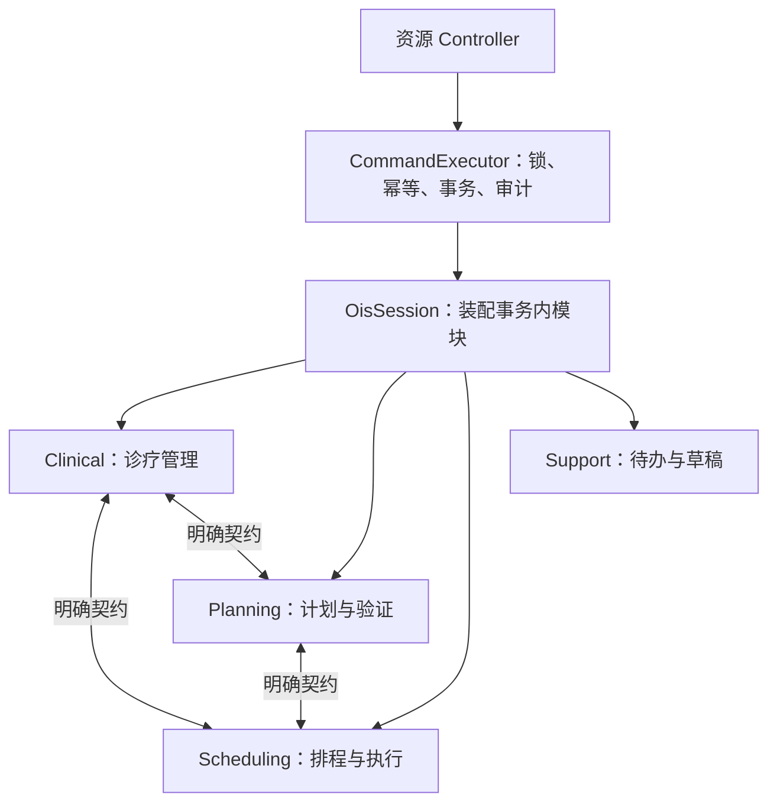

# OIS 架构

浏览器 → 资源 Controller（专用请求类型）→ CommandExecutor（事务）→ OisSession → 所属业务模块 → 领域对象 → MySQL。

## 三个业务模块

当前是模块化单体，三个模块对应候选限界上下文，共享部署和数据库事务。角色工作台不是模块边界；Support 是待办和草稿的公共支撑模块，不是第四个业务微服务。领域关系见 [上下文地图](../CONTEXT-MAP.md)，一致性取舍见 [ADR-0001](adr/0001-modular-monolith.md)。

| 模块 | 数据所有权 | 业务入口与约束 |
| --- | --- | --- |
| Clinical（诊疗管理） | CareCase、Prescription、患者查询 | 档案、处方版本、终止；档案管理当前处方和当前计划引用 |
| Planning（计划与验证） | TreatmentPlan、PhysicalValidation | 计划版本、审核、验证、放行判定；签署结果不可覆盖 |
| Scheduling（排程与执行） | Reservation、OisResource、TreatmentDelivery | 四种排期、资源冲突、机器停用、治疗开始与结束 |

模块由一个 partial class 组成，按业务动作分文件；实体放在各自的 Domain 目录。只有内部构造器接收所属集合，按当前接口与依赖约束，业务方法不接收 OisState、DbContext 或其他业务模块的实体。跨模块使用 `IClinicalContext`、`IPlanningContext`、`ISchedulingContext` 和只读摘要；Support 通过计划模块的 `FailureResolved` 查询判断失败待办能否关闭。

`CareCase.SignPrescription/Terminate/SelectPlan`、`TreatmentPlan.Review/RecordValidation`、`PhysicalValidation.Sign`、预约开始/完成和执行结束等状态变化由领域对象维护。其他排期规则由 SchedulingModule 维护。实体保留原 CLR 命名空间以兼容历史 EF 元数据，但源码按所有权归档；属性不再提供公共 setter，签署验证记录使用 private setter。模块仍在同一程序集，边界通过接口与架构测试约束，尚不是独立程序集或可独立部署的服务。

## 跨模块一致性

- 修订处方：Clinical 先要求 Scheduling 确认没有正在治疗，随后签署新处方并清空当前计划引用；受阻预约待办由 Scheduling 创建。
- 登记计划：Planning 检查临床摘要、处方完整性和机器条件，新增计划后调用 Clinical.SelectPlan 更新当前引用。
- 提交验证：Planning 通过 Scheduling.Experiment 取得已检查版本/状态/时间的摘要，保存独立 PhysicalValidation 并更新计划结论，再由 Scheduling 完成实验占用；设备失败还会停机并创建待办。
- 开始治疗：Scheduling 同步询问 Planning 放行条件，核对当前计划 ID 后记录执行。检查与执行在同一写事务和锁内，不依赖异步缓存。

上述跨模块步骤全部成功才提交。单个 CareCase、TreatmentPlan、Reservation/执行关联承担局部状态约束；跨它们的治疗安全约束仍由事务内协作保证。拆出远程服务之前必须先设计版本凭据、资源占用与失效协议，不能直接把这些调用替换成异步事件。

## 宿主与基础设施

查询由 WorkspaceController → WorkspaceQuery 返回具名 WorkspaceResponse，保持原有聚合快照、首次加载、成功写入后刷新和 30 秒轮询。

后端保留 .NET 10 / ASP.NET Core，入口使用 `WebApplication.CreateBuilder` 和顶层语句，HTTP API 使用 MVC Controller。语法采用 .NET 5 时期的 C# 9 上限，通过 `Directory.Build.props` 的 `LangVersion=9.0` 强制检查；运行时和目标框架仍为 `net10.0`。关闭隐式 global using，源码显式声明 using。

- `frontend/src/OisApp.tsx`：三个角色工作台、表单预览确认、待办、历史和执行。
- `frontend/src/OisCalendar.tsx`：日/周日历、患者预约及机器占用。
- `backend/Program.cs`：创建宿主，在独立作用域内迁移数据库、初始化演示账号，然后启动服务。
- `backend/Hosting/ServiceCollectionExtensions.cs`：`AddClinicServices` 注册 DI、Cookie 认证、授权策略、登录限流、MVC JSON 和 OpenAPI。
- `backend/Hosting/WebApplicationExtensions.cs`：`UseClinicMiddleware` 装配中间件；`MapClinicEndpoints` 映射 Controller、OpenAPI 和根页面回退。
- `backend/Controllers/AuthController.cs`：登录、退出、当前用户和 CSRF 令牌；登录输入为 `Contracts/LoginRequest.cs`。
- `backend/Controllers/`：Cases、Prescriptions、Plans、Reservations、TreatmentDeliveries、Machines、Tasks 按业务资源拆分；Workspace 独立聚合查询。抽象 OisCommandController 只复用身份、请求头和事务调用，没有业务分发。
- `backend/Controllers/HealthController.cs`：数据库健康查询。
- `backend/Controllers/FallbackController.cs`：未知 API 和页面的 404，不显示在 OpenAPI 中；根页面由静态文件及文件回退端点处理。
- `backend/Middleware/`：响应头、业务及系统异常映射、写请求 CSRF 校验。
- `backend/Identity.cs`：演示账号初始化、允许的工作人员角色和 Cookie 登录凭据。
- `backend/Ois/Modules/`：三个业务模块、领域对象，以及公共支撑模块 Support。Controller 通过 `session.Clinical/Planning/Scheduling/Support` 调用具名方法。
- `backend/Ois/OisState.cs`：仅供基础设施使用的 internal 数据容器，不含业务规则，不传给业务入口。
- `backend/Ois/OisSession.cs`：唯一模块装配处；延迟引用只用于闭合事务内同步依赖，不是异步消息。
- `backend/Ois/Contracts/ModuleContracts.cs`：模块间查询/命令与不可修改的摘要。
- `backend/Ois/DomainRules.cs`：无业务状态的通用输入、查找和版本检查。
- `backend/Ois/Requests/`：每个操作独立请求类型；目标 ID 由路由赋值，正文不能覆盖。四种预约分别定义创建请求。
- `backend/Ois/CommandExecutor.cs`：同一事务中的锁、幂等、状态加载、业务委托、持久化和审计。
- `backend/Ois/Compatibility/`：冻结旧字段顺序、默认值及审计操作名称，只用于历史存储兼容，不作为 HTTP 或业务处理契约。
- `backend/Hosting/DatabaseInitialization.cs`：在独立异步作用域中迁移与初始化，保持既有启动行为。
- `backend/ClinicDb.cs` 与 `backend/Ois/Persistence/OisModel.cs`：当前持久化模型。

所有写命令先锁定 OisGate 单行，再读取状态并执行规则；领域变更、待办、审计和幂等结果同事务提交。读取快照用 RepeatableRead。客户端传目标版本，开始治疗还传已核对的计划 id，防止版本被静默替换。

部署只包含应用和 MySQL。前端由 ASP.NET 静态托管；开发时 Vite 代理 API。没有外部同步、影像服务器或模型服务运行依赖。

这是小规模演示设计：全量快照和单行串行写入不适用于生产规模；附件只是外部编号/引用，不上传、不解析。

## 请求与兼容性

中间件顺序为：响应头 → 异常处理 → 默认文件/静态文件 → 路由 → 认证 → 授权 → 登录限流 → CSRF → Controller / OpenAPI / 根页面回退。

Controller 使用 `[ApiController]`、`[Route]`、`[HttpGet]` / `[HttpPost]`，OIS Controller 使用 `[Authorize(Policy = "ois")]`；退出及当前用户接口要求登录，登录接口使用 `[EnableRateLimiting("login")]`。业务角色限制由所属模块的操作方法校验；取消等操作继续按资源实际类型判定角色。

业务路径改为资源和明确动作，例如 `POST /api/ois/plans/{id}/review`、`POST /api/ois/reservations/{id}/experiment-results`；机器可用性和草稿使用 PUT。旧 `/api/ois/commands/*` 已删除并返回 404，仍使用该旧接口的客户端必须同步升级；本次模块化重构保持现有资源 API 不变。认证、健康、workspace 和 OpenAPI 路径保持不变。写请求需要 CSRF，业务写操作还需要幂等键；OpenAPI 按 `[Idempotent]` 元数据描述幂等头，不依赖路径前缀。完整路径见 [操作与接口](ois-runbook.md)。

MVC 的 `AddJsonOptions` 注册 UtcDateTimeConverter，保持 camelCase 与 UTC `Z` 日期输出；中间件的 `WriteAsJsonAsync` 使用单独配置的 HTTP JSON 选项。`[ApiController]` 的模型绑定失败统一返回 400 和 `{ code: "invalid_request", message, correlationId }`。关闭非空引用类型的隐式 Required 校验，以保留 CommandExecutor 与所属模块对缺省字段、显式 null 和业务规则的原有处理。

新增 `SeparatePhysicalValidation` 迁移，将验证字段搬到独立表；历史迁移、外部请求契约、事务、并发和历史幂等指纹算法保留。新增动作将 HTTP 绑定放进 Controller，将规则放进所属模块或领域对象，事务仍由 CommandExecutor 管理。

验证命令：`./scripts/dotnet.sh build ClinicFlow.sln --no-restore`、`./scripts/test.sh --no-restore`，启动新版本 API 后执行 `./scripts/http-tests.sh`。HTTP 测试包含认证、OIS 业务及 Controller 的模型绑定、UTC 序列化、404、OpenAPI 回归；设置 `VERIFY_LOGIN_RATE_LIMIT=1` 可额外验证登录限流。

## 后端代码风格

- 入口 Program.cs 使用 C# 9 顶层语句；其余手写 C#（后端、测试和升级工具）采用块命名空间、普通类、显式构造函数和完整的对象创建类型；DTO 使用属性初始化器。
- 不使用 record / with、主构造函数、目标类型 new()、文件作用域命名空间或集合表达式。条件分支优先使用普通 if / switch 和显式比较。
- 保留 async/await、LINQ、泛型、Nullable、简单表达式体成员和 await using，保持异步、类型检查及资源释放行为。
- 保留 .NET 10 提供的 TimeProvider、限流及 OpenAPI API；语言风格约束不代表运行时依赖回退到 .NET 5。
- Compatibility/LegacyCommandRecord 的属性顺序和默认值与历史格式保持一致，尤其 Available 默认为 true，避免改变持久化幂等指纹。升级演练验证历史请求可重放且不会重复写入。
- 历史 EF 迁移和快照不重写；它们随整个工程在 C# 9 下编译验证。

`Directory.Build.targets` 只移除 Microsoft.AspNetCore.OpenApi 的 XML 注释生成器，因为它自动生成 C# 11+ 文件类型。现有文档由运行时 ApiExplorer / ApiDocumentation 生成；仍保留其他编译分析器。Docker 构建也复制此配置文件。

现代宿主入口只负责 CreateBuilder → 服务注册 → Build → 数据库初始化 → 中间件配置 → 端点映射 → RunAsync。服务注册仍由 IServiceCollection 管理；Controller、CommandExecutor、WorkspaceQuery 和 ClinicDb 继续通过构造函数注入。使用精简宿主不等于使用 Minimal API，本项目业务接口仍由 Controller 定义。

## 原库升级

启动仍执行 MigrateAsync 与 Identity.Seed，本次新增验证记录分离迁移，不清空业务库。迁移顺序为建表、复制历史数据、移除旧列；Down 反向复制后删除新表。详见[数据库与升级](database-design.md)。新请求由兼容模块映射到冻结的历史指纹格式，因此相同账号、角色、key 和业务输入可跨升级重放；输入变化仍冲突。历史审计保留 action 与 detail.command.text，旧备注、更正直接可读；草稿 Payload 表单字段不重命名，原草稿可继续打开和提交。签署成功后仅删除当前账号的对应草稿。

## 读取兼容与验证

WorkspaceQuery 在 RepeatableRead 中读取各模块数据，使用 ReservationResponse 将独立验证记录重新投影到原 `reservations[].reservation` 的字段中，HTTP 路径、请求字段、幂等指纹、前端类型均保持兼容。只读工作台允许跨模块聚合；写入必须走模块入口。

ModuleBoundariesTests 检查模块字段、方法签名和局部变量不引用其他业务模块实体、OisState 或 DbContext，并检查摘要不可修改；ModuleTransactionTests 验证处方修订/开始治疗并发互斥，以及验证失败后各模块、审计和幂等结果整体回滚。PhysicalValidationMigrationTests 验证历史结果迁移、工作台字段以及 Down/Up 往返。
