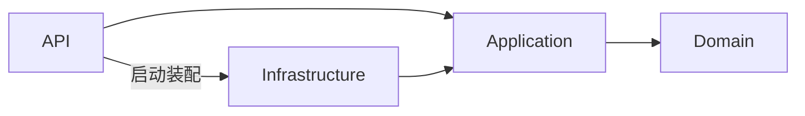

# OIS 架构

当前采用 DDD 四层工程与模块化单体：Domain、Application、Infrastructure、API 分别编译，Clinical、Planning、Scheduling 则是业务边界。层和限界上下文是两个维度；四层不代表四个微服务，三个业务上下文也不要求立即远程部署。

## 项目与依赖

| 工程 | 职责 | 项目引用 |
| --- | --- | --- |
| ClinicFlow.Domain | 实体行为、VerificationProtocol 值对象、SchedulePolicy、领域事件、业务异常 | 无 |
| ClinicFlow.Application | 用例、Commands、模块摘要、事件处理器、事务及查询端口、独立响应 DTO、集成事件契约 | Domain |
| ClinicFlow.Infrastructure | EF 映射和迁移、事务锁和幂等存储、查询投影、账号验证、Outbox 持久化与投递适配 | Application（间接 Domain） |
| ClinicFlow.Api | HTTP 请求绑定与 ToCommand 映射、身份 Cookie、错误码映射、Controller、启动装配 | Application、Infrastructure |

API 引用 Infrastructure 用于启动注册；Controller 通过应用端口工作。Domain 不引用 EF、ASP.NET、数据库或传输契约；Application 不引用 Infrastructure 或 API。Domain 的 BusinessErrorKind 在 API 中转换成 HTTP 状态码。工作台返回独立 DTO，不直接序列化领域实体。

源码从 [Domain](../backend/ClinicFlow.Domain/)、[Application](../backend/ClinicFlow.Application/)、[Infrastructure](../backend/ClinicFlow.Infrastructure/)、[API](../backend/ClinicFlow.Api/) 阅读。领域实体保留历史 CLR 命名空间以兼容 EF 迁移；以程序集依赖确定层级，不能只看 namespace。

## 业务上下文与规则

| 上下文 | 所有权 | 入口 |
| --- | --- | --- |
| Clinical | CareCase、Prescription、Patient | 档案、处方版本、终止、当前方案引用 |
| Planning | TreatmentPlan、PhysicalValidation | 登记、审核、验证、放行判定 |
| Scheduling | Reservation、OisResource、TreatmentDelivery | 预约、资源冲突、停机、单次执行 |

Support 提供待办和个人草稿。上下文关系见[上下文地图](../CONTEXT-MAP.md)。Application/UseCases 内各模块接收所属集合，通过 IClinicalContext、IPlanningContext、ISchedulingContext 和不可修改的摘要协作；不接收其他模块实体或 DbContext。OisSession 装配一次事务内的模块，延迟引用用于闭合同步依赖。

领域对象通过工厂和行为维护状态；实体 setter 不公开，签署结果不能覆盖。应用层负责角色、查询、用例顺序及跨对象检查，领域层负责实体状态与领域策略。跨上下文安全约束仍需要同步查询和同库事务，不能用延迟到达的集成事件代替治疗开始前的检查。

## 写入与事件

1. Controller 将专用 HTTP Request 映射成应用 Command，读取账号、角色、幂等键。
2. CommandExecutor 校验请求、生成兼容历史的指纹，调用 ICommandTransaction。
3. EfCommandTransaction 开启事务、锁定 OisGate 单行，先检查幂等结果，再加载状态。
4. 用例调用领域行为。聚合只记录领域事件，不发送网络消息。
5. OisSession 同步处理领域事件：更新相关模块、创建待办、完成实验占用或停机；映射独立 V1 集成事件。
6. 状态、审计、幂等结果与 OutboxMessage 同事务写入并提交；任一步失败整体回滚。
7. 可选的 OutboxDispatcher 在另一事务中投递已经提交的消息。默认没有传输实现或后台消费者。

处方更新清空当前计划后，PrescriptionSigned 触发待办；PlanRegistered 触发当前计划引用更新；PlanValidated 触发实验完成以及失败处理；TreatmentFinished 的中断结果触发待办。详情、契约版本和重试语义见[领域事件与集成事件](events.md)。

同 key 同输入重放直接返回存储结果，不再次执行领域行为或生成事件；不同输入仍冲突。历史指纹和审计格式由 Application/Compatibility 保留。时钟通过 TimeProvider 注入；领域方法使用显式时间参数。

## 查询与基础设施

WorkspaceController → IWorkspaceReader → EfWorkspaceReader。在 RepeatableRead 中读取并投影完整工作台；ReservationProjection 将独立验证结果还原到兼容的响应字段。前端仍在首次加载、写入成功及每 30 秒刷新快照。

ClinicDb、OisModel、OisStateStore 位于 Infrastructure/Persistence；OisState 是 Application 的内部工作集，基础设施通过友元程序集装载它。它不包含规则、不作为公开契约。EF 所需映射、锁记录和审计记录留在基础设施。

启动链路：Program → AddClinicServices/AddClinicInfrastructure → Build → InitializeClinicInfrastructure（迁移与 StaffAccounts.Seed）→ 中间件 → Controller。认证控制器通过 IStaffAuthenticator 获取身份，再由 API 的 Identity 创建 Cookie。业务模块自行校验具体操作角色。

中间件顺序：响应头 → 异常处理 → 默认文件/静态文件 → 路由 → 认证 → 授权 → 登录限流 → CSRF → 端点。模型绑定错误返回统一 invalid_request；UTC 转换器、OpenAPI、资源 URL 和业务响应保持兼容。

## 范围、兼容性与验证

部署仍只有应用和 MySQL，前端静态托管。全量工作集和单行写锁适用于演示，仍限制吞吐量；附件是外部引用，不上传或解析。未实现跨服务 Inbox、消息总线、生产调度器或独立服务部署。

历史迁移保留；SeparatePhysicalValidation 分离验证记录，AddIntegrationOutbox 仅新增消息表。迁移项目现在是 ClinicFlow.Infrastructure，启动项目是 ClinicFlow.Api。升级与回退约束见[数据库](database-design.md)、[运行手册](runbook.md)及 [ADR-0002](adr/0002-layered-events.md)。

验证：`./scripts/dotnet.sh build ClinicFlow.sln --no-restore`、`./scripts/test.sh --no-restore`，新 API 启动后执行 `./scripts/http-tests.sh`。LayerTests 约束程序集依赖与响应隔离；ModuleBoundariesTests 约束模块所有权；ModuleTransactionTests 验证安全并发、事件处理回滚、幂等重放；OutboxTests 验证失败退避与重复投递标识；迁移测试与升级演练覆盖旧数据兼容。

.NET 10 运行时与 C# 9 语法上限保持不变。手写代码采用普通类、块命名空间、显式 using 与构造函数，不使用 record、主构造函数或文件作用域命名空间。Directory.Build.targets 仅移除会生成新语法的 OpenAPI XML 注释生成器，运行时 OpenAPI 文档不受影响。
